<!--
  个人主页草稿 v1：华丽符卡风格，蕾米莉亚的红色定主色调。
  卡面图片在 cards/，由 build_cards.py 生成。
-->

<h1 align="center">晓煜的卡组</h1>

stmluyuer · 手牌 5 张 · 红魔馆常客

  
  
  
  
  

▼ 点开牌名，翻看卡牌效果

<b>01 · 自机牌 · 晓煜</b>

> 弹幕再密，判定点也只有这么一点。

**效果**：登场时，向翻到这张牌的人打个招呼。 
**自我介绍**：红魔馆的常客，偶尔获准进图书馆借书。 
**关键词**：帕秋莉的图书馆（啃文档）· 咲夜的怀表（赶工）· 美铃的午睡（摸鱼）

<b>02 · 符卡 · 工符「Godot 工坊」</b>

> 先做出来，再慢慢变好玩。

**效果**：把一个点子放到场上。回合结束时，它会变成能玩的原型，或者一个新 Bug。 
**常用**：Godot · GDScript · C#

<b>03 · 道具牌 · 红魔馆的请柬</b>

> 今晚的月亮是红色的。

**效果**：持有期间，可以随时拜访红魔馆。门番多半在打瞌睡，进门前记得先向女仆长打招呼。 
**本命**：蕾米莉亚·斯卡雷特 
**也喜欢**：红魔馆的大家，秋静叶 · 秋穰子 
**常听**：《亡き王女の為のセプテット》《ラクトガール ～ 少女密室》

<b>04 · 事件牌 · 异变进行中</b>

> 红雾还没散，山上的叶子已经红了。

**效果**：公开当前正在发生的异变。这张牌会不定期更换。 
**当前异变**：在红魔馆地下室挖了一条联机地洞（NetBurrow）。

<b>05 · 诅咒牌 · 东方厨</b>

> 不能打出，也不能移除。

**效果**：每回合开始时，脑内自动播放一首红魔乡的曲子。 
**解除条件**：无。

---

本页卡牌是东方Project的二次创作，非官方内容。东方Project 原作：上海アリス幻樂団

